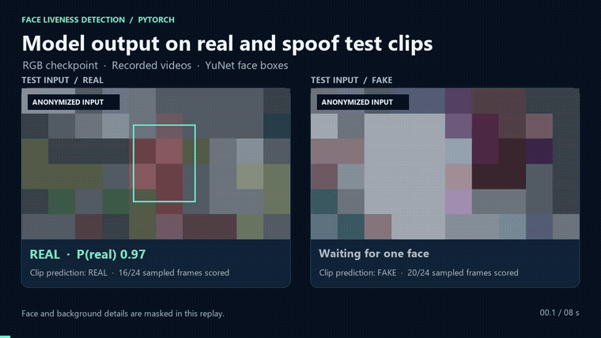
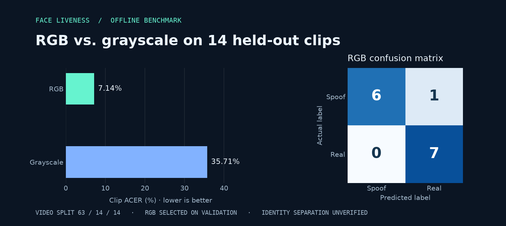

# Face Liveness Detection | PyTorch

**Nguyễn Chiến Thắng** · Personal project · Python / PyTorch / OpenCV / Streamlit

A passive face liveness prototype trained on 91 videos I recorded. It uses YuNet to locate a face, a compact CNN to score 32 × 32 crops, and the mean frame score to classify a clip as real or spoof.

## Inference demo

[](docs/media/inference-demo.mp4)

[Watch the MP4](docs/media/inference-demo.mp4) · [Open a still frame](docs/media/inference-preview.png)

This replay shows the RGB checkpoint running on two clips from the test split. The face boxes and scores come from inference on the original frames. The preview masks face and background details. The overlay averages the latest six eligible frames. The clip predictions below it use the same sampling protocol as the benchmark.

## What you can run

| Interface | Entry point |
| --- | --- |
| Training, single-video prediction, split evaluation and export | [personal_liveness.py](personal_liveness.py) |
| Desktop webcam, video playback and annotated MP4 | [desktop.py](desktop.py) |
| Browser webcam and REST API for images, live sessions and video | [api.py](api.py), [browser UI](static/index.html), [API guide](docs/API.md) |
| Python CLI for API requests | [client.py](client.py) |
| Local video upload demo | [app.py](app.py) |

## Results



I recorded 47 spoof and 44 real clips. I assigned clips to train, validation and test before sampling frames, using a stratified split of **63 / 14 / 14 videos**. Of 2,098 sampled frames, 1,712 contained one face suitable for scoring. Both CNNs started from random weights and were trained for 15 epochs on CPU.

| Input | Checkpoint selected at epoch | Spoof clips accepted | Genuine clips rejected | Test clip ACER |
| --- | ---: | ---: | ---: | ---: |
| **RGB** | 7 | **1/7** | **0/7** | **7.14%** |
| Grayscale | 6 | 5/7 | 0/7 | 35.71% |

The RGB variant was selected using validation clip ACER, with validation frame loss as the tie-breaker. It classified **13 of 14 test clips** correctly. ACER here averages the spoof acceptance rate and genuine rejection rate at the fixed 0.50 threshold. [Full benchmark and confusion matrices](docs/benchmark.json)

## Method

1. Sample approximately 2 frames per second from the first 12 seconds of each clip.
2. Detect faces with YuNet. Keep frames with exactly one detection, then crop, resize and normalize to 32 × 32 RGB.
3. Train the same three-block CNN with RGB or grayscale input. Weight frames inversely by the number of eligible frames in their training clip so longer clips do not dominate.
4. Average the sigmoid scores across eligible frames. A score above 0.50 yields `real`. A clip without eligible frames remains unscored.


## Run locally

Use Python 3.11 from the repository root. The detector is bundled. Install PyTorch and the remaining dependencies into a virtual environment:

```bash
python -m pip install torch==2.5.1 --index-url https://download.pytorch.org/whl/cpu
python -m pip install -r requirements.txt
```

Organize your local videos under `recordings/Video real/` and `recordings/Video fake/`. Use at least seven clips per label. Keep each folder's recordings fixed to reproduce its seed-based split.

```bash
python personal_liveness.py prepare --data path/to/recordings
python personal_liveness.py train --epochs 15
python personal_liveness.py predict --model artifacts/personal/liveness_rgb.pt --video path/to/clip.mp4
python personal_liveness.py evaluate --split test
python personal_liveness.py export --output artifacts/export/liveness_rgb.torchscript.pt
```

The export contains the CNN. Feed normalized NCHW tensors of 32 × 32 crops and apply sigmoid to the output logit for the real class.

## Desktop webcam and annotated video

```bash
python desktop.py --camera 0
python desktop.py --video path/to/clip.mp4 --headless --output artifacts/annotated.mp4
```

Use **Q** or **Esc** to close the desktop window. Change `--camera 0` to the index of your device. For the on-screen decision, the app averages up to six consecutive scored frames and clears that window when there is no eligible face.

## Browser webcam and API

```bash
python -m pip install -r requirements-api.txt
python api.py
```

Open [http://127.0.0.1:8000](http://127.0.0.1:8000), click **Start camera** and grant camera access. The web interface sends frames to the local API and draws the detected box and smoothed score. You can also call the same API from Python:

```bash
python client.py --image path/to/frame.jpg
python client.py --video path/to/clip.mp4
```

The API listens on localhost and needs no key. [Endpoints and examples](docs/API.md)

## Streamlit video demo

```bash
python -m pip install -r requirements-demo.txt
python -m streamlit run app.py
```

Choose a checkpoint and upload a video to get the label, score and frame coverage. Videos, cached face crops and trained checkpoints stay on the machine. The repository includes the source and aggregate benchmark.

Run the API contract checks with `python -m unittest discover -s tests` after installing the API requirements.

## Evaluation scope

The test set contains 14 videos. It was separated by video; identity and session separation were not verified. The scores describe this small offline experiment. Testing on new identities, cameras and attack media is needed to measure generalization.

Face detection uses the MIT-licensed [YuNet model from OpenCV Zoo](https://github.com/opencv/opencv_zoo/tree/main/models/face_detection_yunet). [Bundled license](face_detector/LICENSE)
